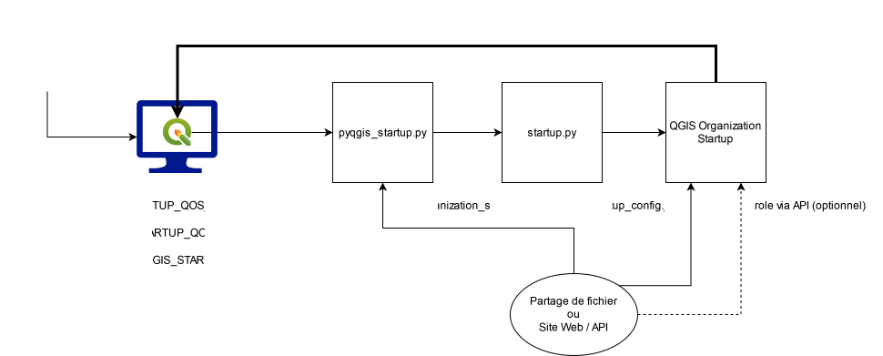

# QGIS Organization Startup

Ce paquet permet de gérer de manière centralisée le paramétrage de QGIS au démarrage.
Les paramétrages peuvent être appliqués en fonction d'un utilisateur, d'un role ou d'un site.

QGIS Organization Startup est compatible avec QGIS 3.xx (testé sur 3.40.6) et 4.xx (testé sur 4.1)

_N.B.: Le développement a été réalisé dans un environnement Windows 10/11 + Active Directory. Toutes les fonctionnalités liées à l'identification de l'utilisateur ne sont pas opérationnelles sur Linux et MacOS._

## Fonctionnement général

## Installation

### Etape 1 - Déployer QGIS Desktop

Déployer QGIS Desktop sur les postes avec la méthode que vous souhaitez.

### Etape 2 - Déployer les variables d'environnement sur les postes.
   
| Variable d'environnement                                  | Valeur                                                                                                                        |
|-----------------------------------------------------------|-------------------------------------------------------------------------------------------------------------------------------|
| PYQGIS_STARTUP_QOS_CONFIG_URI                             | **Fichier:** file:///path/to/startup_config.json  **URL:** https://www.exemple.com/api/startup_config                      |
| PYQGIS_STARTUP_QOS_PKG_URI                                | **Fichier:** file:///path/to/qgis_organization_startup.whl  **URL:** https://www.exemple.com/qgis_organization_startup.whl |
| PYQGIS_STARTUP_QOS_STARTUP_URI (Optionnel) 1   | **Fichier:** file:///path/to/startup.py  **URL:** https://www.exemple.com/startup.py                                       |
| PYQGIS_STARTUP                                            | /path/to/pyqgis_startup.py                                                                                                    |

1 _Par défaut, un fichier `startup.py` est automatiquement généré par `pyqgis_startup.py`_

### Etape 3 - Déployer le fichier `pyqgis_startup.py` sur les postes.

Ce fichier est à déployer n'importe où sur le poste de l'utilisateur. 
Il faut cependant que son chemin d'accès soit celui indiqué dans la variable `PYQGIS_STARTUP`.

Utiliser le fichier [pyqgis_startup.py de ce projet](pyqgis_startup.py).
   
### Etape 4 - Paramétrer le fichier de configuration

S'aider du [fichier d'exemple starttup_config.json](example/startup_config.json) pour créer le fichier qui sera déclaré dans la variable `PYQGIS_STARTUP_QOS_CONFIG_URI`

### Etape 5 - Paramétrer la récupération du role

L'identification du rôle de l'utilisateur est uniquement réalisé par une requête GET, en indiquant l'email de l'utilisateur dans le paramètre de l'URL. Il faut donc prévoir de mettre à disposition une API permettant:
- de réaliser une requête GET sur `<role_url>?user_mail=user@exemple.com` (<role_url> étant à indiquer dans le fichier de config)
- de renvoyer la réponse `{"role": "role_exemple"}`

_N.B.: Une notion de groupe dans le fichier de config sera prochainement ajoutée pour identifier les groupes auxquels appartient l'utilisateur sur l'annuaire d'entreprise._

### Etape 5 - Déployer le fichier de config et le paquet qgis_organization_startup

Il est possible de mettre à disposition ces deux fichiers soit sur un système de fichier (partage réseau) ou via une URL de téléchargement.

